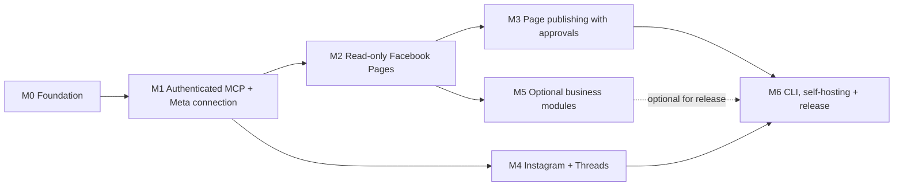

# Meta Master Worker MCP — Development roadmap

> Maintained roadmap · 2026-11-12 · Initial release target: a useful, single-operator, self-hosted Facebook Pages MCP. This is a **scope and dependency plan**, not a delivery-date promise. See [technology stack](tech-stack.md), [architecture](architecture.md) and [security](security.md).

## Guiding decisions

1. **Own use first.** The first acceptance test uses a Page that the operator actually administers; public multi-user onboarding is later.
2. **Cloudflare-native TypeScript.** Avoid unnecessary language, runtime and infrastructure fragmentation.
3. **Secure by construction.** Separate MCP-client identity from Meta authorisation, verify account/resource ownership for every call, and require server-side approval for writes.
4. **Real API evidence.** An endpoint is not "supported" until permission requirements, error handling and at least one authorised live test are recorded.
5. **Modular over maximum tools.** Keep each Meta platform optional and only expose tools the current connection may use.
6. **Public repo, private credentials.** CI tests without secrets. Production configuration and deployments require explicit authorisation.

## Dependency overview

**Release strategy:** A useful private-operator `v0.1` can ship after M3, without waiting for M4 or M5. The wider self-hosted `v1.0` launch belongs to M6 after security, docs and permission matrices are mature.

## M0 — Foundation and engineering baseline

**State: completed for foundation baseline.** No Meta integration exists yet. **Priority: P0.**

Already committed:
- [x] Public repository, base README and agent guidance.
- [x] TypeScript Cloudflare Worker skeleton; health route; `/mcp` deliberately returns 503.
- [x] Wrangler config, Vitest test source, CI workflow with verified successful Node 24 run.
- [x] Initial security rules and architecture documentation.
- [x] Roadmap and technology-selection record.

Completion checklist:
- [x] Produce and commit a reproducible npm lockfile; change CI to `npm ci`.
- [x] Verify Node 24 CI: locked install, TypeScript, Vitest and Worker dry-run succeeded ([run 43281910212](https://github.com/cryogenized-spec/meta-master-worker-mcp/actions/runs/43281910212); [record](m0-verification.md)).
- [x] Define an explicit threat model covering credential exposure, OAuth CSRF, cross-account access, replay, forged approvals, SSRF and logging. See [threat model](threat-model.md).
- [x] Choose the Cloudflare Workers OAuth Provider v1 split architecture and official MCP TypeScript SDK for M1. See [authentication decision](auth-design.md).
- [x] Keep errors constant and add allowlisted event shapes plus tests that sensitive error causes cannot be reflected.
- [x] Add a no-credentials environment template; M1 will document the future secret binding names.
- [x] Verify all supported methods on `/mcp` return 503, even with fabricated bearer tokens or approval headers; OAuth routes return 404.

**Exit gate:** CI confirmed green from GitHub, reproducible install, documented auth design and no active unauthenticated tools. **No deployment required.**

**Next-stage gate:** Implement and version-test the actual MCP/OAuth SDK integration in M1 before enabling `/mcp`; documenting the decision in M0 is not a compatibility test.

## M1 — Authentication, account connection and MCP protocol

**State: in progress — M1.1 protected transport and M1.2a foundations validated. M1.2b adds browser-bound consent and GitHub verified operator ID with PKCE; M1.2c adds the internal encrypted D1 connection adapter. M1.2d verifies OAuth grants and the vault against local workerd KV/D1; M1.3 adds the constrained read-only Graph v27 client and operator-scoped Page discovery service. Live OAuth configuration, Cloudflare provisioning and actual Meta account onboarding remain outstanding. Priority: P0. Depends on M0.**

- [x] Implement and bundle stateless SDK v2 Streamable HTTP MCP resource handler behind Cloudflare OAuthResourceServer; verify fail-closed configuration and scope enforcement in code. [CI](m1-validation.md).
- [x] Verify consent browser binding, one-time OAuth codes, resource audience and token revocation against local workerd KV using OAuth Provider. [M1.2d](m1-2d.md).
- [ ] Verify real remote client authentication, scope checks and transport interoperability across deployed resource/issuer Workers and real test clients.
- [x] Create separate OAuth issuer Worker shell with denied-by-default /authorize, scope restriction and configuration validation. [M1.2a](m1-2a.md).
- [x] Implement GitHub OAuth PKCE operator verification and browser-bound read-only MCP client consent source code and unit tests. [Design](m1-2b.md).
- [ ] Verify actual operator sign-in, client consent, live token issuance/revocation and MCP interoperability against configured OAuth KV, a registered GitHub app and private service bindings.
- [ ] Implement Meta OAuth onboarding for operator-controlled assets with CSRF-safe single-use state and exact redirect URI binding.
- [x] Implement and test AES-256-GCM token envelope primitives with per-connection authenticated context and draft ciphertext-only D1 migration.
- [x] Implement internal D1 adapter with ciphertext-only create/read, operator-scoped metadata listing, expiry filtering and audited local disconnect. [M1.2c](m1-2c.md).
- [x] Execute D1 schema and encrypted vault lifecycle against local workerd D1/KV, including transaction rollback and cross-operator isolation. [CI](m1-2d.md).
- [ ] Provision private Cloudflare D1/KV, apply migration to a real test database, and implement provider-side revocation, safe refresh and key rotation.
- [x] Implement pinned Meta Graph v27.0 read-only Page-discovery client with allowlisted endpoint, bounded retries and redacted errors, plus operator/scopes vault checks. [M1.3 design](m1-3.md).
- [ ] Verify this Graph client with an authorised live Meta developer account and Page before treating its endpoint as supported.
- [ ] Implement account and permission diagnostics: connected identity, effective scopes, assets, Page tasks and missing authorisations.
- [ ] Ensure unauthenticated, expired, cross-account and insufficient-scope requests fail closed.
- [ ] Connect one authorised Meta developer/test account without recording any secrets in CI.

**Exit gate:** an authorised MCP client connects securely and can discover eligible Page identities; denied clients cannot list accounts or issue Graph requests. Verify full disconnect flow.

## M2 — Read-only Facebook Pages (first genuinely useful feature)

**State: planned. Priority: P0. Depends on M1.**

- [ ] `facebook_pages_list` — discover Pages for the connected identity.
- [ ] `facebook_page_get` — eligible Page profile, metadata and settings fields.
- [ ] `facebook_page_posts_list` and `facebook_page_post_get`.
- [ ] `facebook_page_comments_list` where permissions allow.
- [ ] `facebook_page_insights_get` where metrics and insights permissions are available.
- [ ] Cursor pagination, field allowlisting, structured paging errors, rate-limit diagnostics.
- [ ] Record a per-tool permission matrix and live test against an authorised Page.
- [ ] Show usable explanations when an account is ineligible or a scope is absent, without implying authorisation that hasn't been granted.

**Exit gate:** a client retrieves real, permitted Page information, posts and available insights; failures are tested and understandable. **Candidate `v0.1-readonly`.**

## M3 — Facebook Pages publishing, scheduling and moderation

**State: planned. Priority: P1. Depends on M2.**

- [ ] Server-side draft creation and preview without publishing.
- [ ] Approval record bound to actor, Page, operation, exact payload digest, expiry and one-time consumption.
- [ ] Publish supported text/media posts; use R2 only where temporary media hosting is required.
- [ ] Supported native scheduling and schedule inspection; check the actual published/scheduled state.
- [ ] Idempotency tokens, retry-safe write execution and audit records.
- [ ] Explicitly authorised comment replies/moderation where permissioned; destructive actions demand stronger confirmation.
- [ ] End-to-end tests covering approval mismatch, repeat approval, missing permissions, external API failures and duplicate requests.
- [ ] Live test: approved test post and scheduled post on an operator-controlled Page, with cleanup requiring its own approval.

**Exit gate:** a draft cannot publish without independent server-side confirmation, writes are traceable and retries do not unintentionally duplicate posts. **Candidate operator `v0.1`.**

## M4 — Instagram and Threads adapters

**State: planned. Priority: P2. Depends on M1; sharing the approval service from M3 is recommended.**

- [ ] Separate platform-specific account onboarding, eligible profile discovery and permission checks.
- [ ] Read permitted account information, posts/replies and insights where available.
- [ ] Approved supported publishing operations with platform-specific media validation.
- [ ] Account switching and cross-post drafts without accidental cross-account publication.
- [ ] Live tests and documented permission/API-version matrix for each platform.

**Exit gate:** each adapter demonstrates at least one real authorised read workflow and one independently approved eligible publish workflow, or documents why platform permissions block writes.

## M5 — Optional business extensions

**State: planned. Priority: P3. Modules may be developed independently after M1/M2.**

**Messenger**
- [ ] Page conversation access and message-window/permission safeguards.
- [ ] Explicitly approved outbound responses; audit and webhook signature validation.

**WhatsApp Business**
- [ ] Business account onboarding, template inspection, permitted messaging and conversation handling.
- [ ] Verify Meta business eligibility, phone-number scope, template and messaging policy.

**Meta Ads**
- [ ] Read-only account/campaign/adset/creative discovery and reporting first.
- [ ] Any budget or campaign change has a separate, higher-friction approval and hard spending controls.

**General**
- [ ] Review each module's current Meta app-review and business-verification requirements.
- [ ] Provider webhooks: verify signatures on raw body and deduplicate delivery.
- [ ] Keep disabled modules absent from tool discovery.

**Exit gate:** each enabled optional module passes its own scopes, ownership, security and live workflow tests. Optional modules do **not** block the useful core release.

## M6 — CLI, administrative UX and public self-hosting release

**State: planned. Priority: P2 after M3, even if M4/M5 remain optional.**

- [ ] Thin TypeScript CLI sharing the authorised service layer; commands for auth status, Pages, posts and drafts.
- [ ] Simple connected-account/permission dashboard; adopt React+Vite only if necessary.
- [ ] One-command local setup and Cloudflare deploy documentation with D1 migrations, key rotation and restoration procedures.
- [ ] Repeatable integration tests, security tests, dependency review and a maintained support matrix.
- [ ] Decide and publish licence after third-party code audit; add contribution and disclosure guidelines.
- [ ] Versioned release notes, tagged deployments and manually approved production deployment path.
- [ ] Document unsupported personal-profile posting and deprecated Groups API features rather than implying they work.

**Exit gate:** another developer can self-host with their *own* Meta application, tokens stay private, the release has reproducible builds, and every advertised tool is qualified by tested support.

## Cross-cutting acceptance rules for every milestone

- CI typecheck/tests/build complete without real credentials.
- Write tools always require explicit server-side, resource- and payload-bound approval.
- No automatically deployed infrastructure from untrusted PRs.
- Tool discoverability is permission-aware; inactive modules are hidden.
- Test fixtures cannot contain live tokens or personal customer data.
- Errors distinguish authentication, authorization, rate limits, unavailable fields and platform failures.
- No issue is marked done solely because a mock test passes if the milestone requires live integration.

## Immediate next work (ordered)

1. [M1.2d complete locally](m1-2d.md). Register a private GitHub OAuth application for operator identity verification and configure Cloudflare secret bindings; no credential values in Git.
2. Provision OAuth KV, service bindings and run real OAuth consent/PKCE/revocation tests in a controlled environment.
3. Implement the D1 ciphertext storage adapter, disconnect and key rotation.
4. Implement Meta OAuth onboarding and safe Graph API client with a documented permission matrix.
5. Verify first authorised Facebook Page listing.

**Non-goal:** relying on browser scraping or bypassing Meta restrictions to automate personal profiles or Groups.
